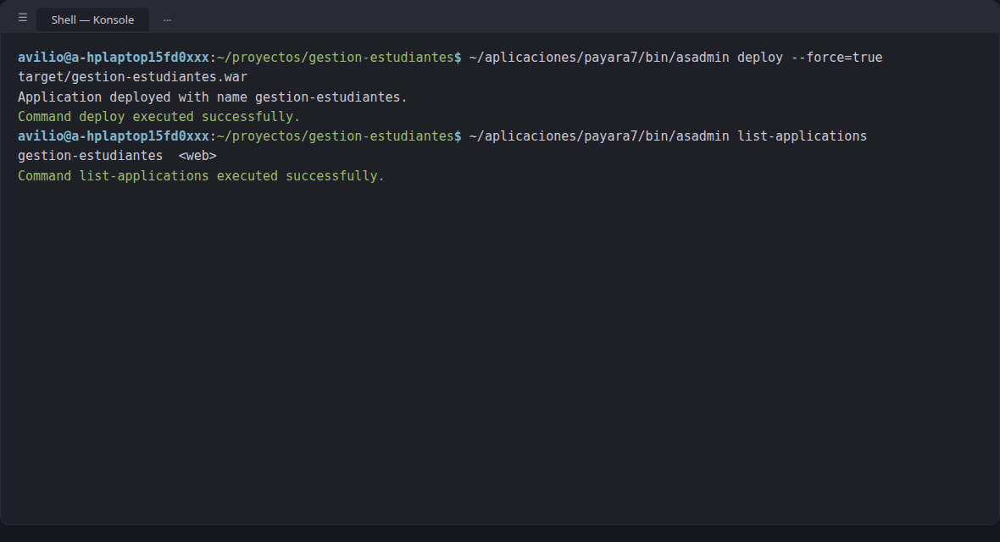
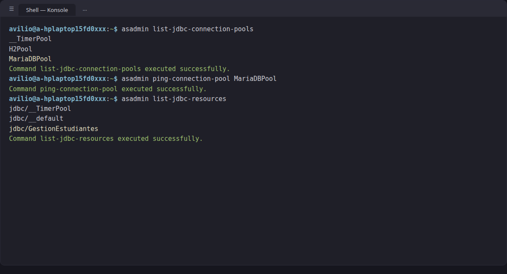
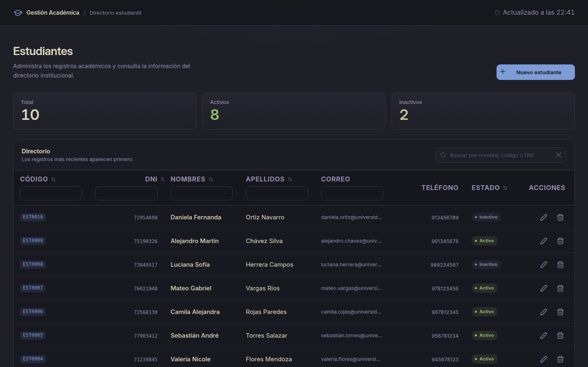
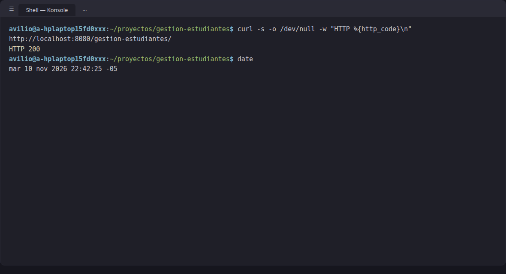

# 🎓 Sistema de Gestión de Estudiantes


Aplicación web académica desarrollada con **Java 21, Jakarta Faces, PrimeFaces 16, Maven, Payara 7 y MariaDB**. Un único proyecto cubre los dos objetivos indicados por el docente:

| Objetivo | Entregable |
|----------|------------|
| **Nota de participación** | CRUD de estudiantes con PrimeFaces + MariaDB: directorio, búsqueda, KPIs, validaciones y confirmación al eliminar |
| **Nota de aptitud** | Empaquetado WAR con Maven, configuración del servidor (pool JDBC + JNDI) y despliegue en Payara 7 |

---

## Funcionalidades

- **CRUD completo** de estudiantes con validaciones en servidor y cliente (`required`, `maxlength`, `f:validateRegex`).
- **Búsqueda global** instantánea (`onkeyup`) con botón de limpiar.
- **KPIs** — total, activos e inactivos — que se actualizan tras crear, editar o eliminar.
- **Diálogo de confirmación** antes de eliminar (acción no reversible).
- **Tema oscuro Kanagawa** con tipografía Inter (variable), favicon SVG y overrides CSS de PrimeFaces (sin franjas blancas).
- **Responsive**: en móvil la tabla usa `reflow` de PrimeFaces.

## Evidencias

Todas las capturas son **reales**, sin generación IA: la aplicación se fotografió con Brave y las salidas de `asadmin` y `curl` provienen de comandos ejecutados realmente en terminal. Cada captura también está disponible en [`docs/capturas/`](docs/capturas/).

### Nota de participación · Aplicación

Recorrido por el flujo completo del CRUD en escritorio (1440px).

**1 · Directorio de estudiantes**

<p align="center">
  
</p>

_Página inicial: KPIs de total (10), activos (8) e inactivos (2), y tabla ordenada con los registros más recientes primero._

**2 · Búsqueda en tiempo real**

<p align="center">
  
</p>

_El filtro global filtra todas las columnas al escribir; el botón ✕ lo limpia._

**3 · Crear estudiante**

<p align="center">
  
</p>

_Formulario con envío AJAX; al guardar muestra un growl de éxito y la tabla se refresca sola._

**4 · Validaciones**

<p align="center">
  
</p>

_Mensajes de error específicos por campo; los opcionales (teléfono, correo) permiten vacío._

**5 · Editar estudiante**

<p align="center">
  
</p>

_El formulario se precarga con los datos del registro y guarda los cambios con AJAX._

**6 · Eliminar con confirmación**

<p align="center">
  
</p>

_Diálogo previo a la acción: no se elimina nada sin confirmar._

**7 · Vista móvil (390px)**

<p align="center">
  <a href="docs/capturas/participacion/07-movil.png">
    
  </a>
</p>

_En pantallas pequeñas la tabla cambia a modo `reflow` de PrimeFaces; la captura completa es una imagen larga ([ver original](docs/capturas/participacion/07-movil.png))._

### Nota de aptitud · Payara 7

De código fuente a aplicación servida por el servidor, paso a paso:

**1 · Compilación y empaquetado del WAR**

<p align="center">
  
</p>

_`mvn clean package` termina en `BUILD SUCCESS` y genera `target/gestion-estudiantes.war` (5,4 MB)._

**2 · Despliegue en Payara**

<p align="center">
  
</p>

_`asadmin deploy --force=true` despliega la app y `list-applications` la muestra como aplicación web activa._

**3 · Pool JDBC y recurso JNDI**

<p align="center">
  
</p>

_El pool `MariaDBPool` responde al ping con éxito y el recurso `jdbc/GestionEstudiantes` queda registrado en el servidor._

**4 · Aplicación servida por Payara**

<p align="center">
  
</p>

_La página carga con datos reales desde MariaDB (10 estudiantes) servida por Payara en `http://localhost:8080/gestion-estudiantes/`._

**5 · Verificación HTTP**

<p align="center">
  
</p>

_`curl` confirma HTTP 200 en la URL del despliegue._

### Base de datos · MariaDB

La base de datos detrás del CRUD, vista en phpMyAdmin con las tablas y sus relaciones.

**1 · Estructura SQL**

<p align="center">
  
</p>

_Las tres tablas se crean con el esquema de la sección [Base de datos](#base-de-datos)._

**2 · Tabla `estudiantes`**

<p align="center">
  
</p>

_Estructura con clave primaria, campos únicos (`codigo`, `dni`, `correo`) y enumerados de estado._

**3 · Datos de demostración**

<p align="center">
  
</p>

_Los 10 estudiantes del script `demo_data.sql`, visibles también en la tabla de la aplicación._

**4 · Tabla `matriculas`**

<p align="center">
  
</p>

_Claves foráneas a `estudiantes` y `carreras`, con la llave única (estudiante, carrera, periodo)._

**5 · Diseñador ER — relaciones**

<p align="center">
  
</p>

_`estudiantes` ↔ `matriculas` ↔ `carreras`: así conecta el DAO las consultas del CRUD._

## Tecnologías

| Componente | Tecnología | Versión usada |
|------------|------------|---------------|
| Lenguaje | Java (OpenJDK, Debian) | 21.0.13 |
| Plataforma | Jakarta EE | 11 |
| Vista web | Jakarta Faces (Facelets) + PrimeFaces | 16.0.0 |
| Inyección de dependencias | CDI | — |
| Construcción | Maven | 3.9.12 |
| Servidor | Payara Server | 7 |
| Base de datos | MariaDB (XAMPP para Linux, `/opt/lampp`) | 10.4.32 |
| Acceso a datos | JDBC + MariaDB Connector/J | 3.5.11 |
| Empaquetado | WAR | — |
| Tema | Kanagawa (oscuro) | — |
| Fuente | Inter (variable) | — |
| Favicon | SVG (Gestión Académica) | — |

## Estructura del proyecto

```
.
├── database/
│   ├── schema.sql                # Estructura: carreras, estudiantes, matriculas
│   └── demo_data.sql             # Datos demo: 5 carreras, 10 estudiantes, 10 matrículas
├── docs/capturas/
│   ├── participacion/            # Evidencias de la nota de participación
│   ├── aptitud/                  # Evidencias del despliegue en Payara 7
│   └── base-datos/               # Evidencias de MariaDB / phpMyAdmin
└── src/main/
    ├── java/pe/edu/gestionestudiantes/
    │   ├── dao/EstudianteDAO.java        # Acceso a datos (JDBC)
    │   ├── modelo/Estudiante.java        # Entidad
    │   └── web/EstudianteBean.java       # Backing bean CDI
    └── webapp/
        ├── index.xhtml                   # Vista única (JSF + PrimeFaces)
        ├── resources/css/app.css         # Tema Kanagawa + overrides PrimeFaces
        ├── resources/fonts/InterVariable.woff2
        └── resources/img/favicon.svg
```

## Base de datos

Base de datos `gestion_estudiantes` con las tablas `estudiantes`, `carreras` y `matriculas`. Los scripts reproducibles están en [`database/schema.sql`](database/schema.sql) y los datos de demostración en [`database/demo_data.sql`](database/demo_data.sql). El esquema completo:

```sql
CREATE DATABASE IF NOT EXISTS gestion_estudiantes
  CHARACTER SET utf8mb4 COLLATE utf8mb4_unicode_ci;

USE gestion_estudiantes;

CREATE TABLE IF NOT EXISTS carreras (
    id BIGINT UNSIGNED AUTO_INCREMENT PRIMARY KEY,
    codigo VARCHAR(15) NOT NULL UNIQUE,
    nombre VARCHAR(120) NOT NULL UNIQUE,
    duracion_semestres TINYINT UNSIGNED NOT NULL,
    estado ENUM('ACTIVA', 'INACTIVA') NOT NULL DEFAULT 'ACTIVA'
) ENGINE=InnoDB;

CREATE TABLE IF NOT EXISTS estudiantes (
    id BIGINT UNSIGNED AUTO_INCREMENT PRIMARY KEY,
    codigo VARCHAR(15) NOT NULL UNIQUE,
    dni VARCHAR(15) NOT NULL UNIQUE,
    nombres VARCHAR(100) NOT NULL,
    apellidos VARCHAR(100) NOT NULL,
    correo VARCHAR(150) UNIQUE,
    telefono VARCHAR(20),
    fecha_nacimiento DATE,
    estado ENUM('ACTIVO', 'INACTIVO') NOT NULL DEFAULT 'ACTIVO',
    fecha_registro TIMESTAMP NOT NULL DEFAULT CURRENT_TIMESTAMP
) ENGINE=InnoDB;

CREATE TABLE IF NOT EXISTS matriculas (
    id BIGINT UNSIGNED AUTO_INCREMENT PRIMARY KEY,
    estudiante_id BIGINT UNSIGNED NOT NULL,
    carrera_id BIGINT UNSIGNED NOT NULL,
    periodo VARCHAR(10) NOT NULL,
    fecha_matricula DATE NOT NULL,
    estado ENUM('MATRICULADO', 'RETIRADO') NOT NULL,
    FOREIGN KEY (estudiante_id) REFERENCES estudiantes(id),
    FOREIGN KEY (carrera_id) REFERENCES carreras(id),
    UNIQUE KEY unique_matricula (estudiante_id, carrera_id, periodo)
) ENGINE=InnoDB;
```

## Puesta en marcha

### Requisitos previos

| Requisito | Verificación |
|-----------|--------------|
| JDK 21 instalado y configurado | `java -version` y `javac -version` |
| Maven instalado | `mvn -version` |
| Payara Server 7 instalado | `asadmin version` |
| MariaDB en ejecución | `/opt/lampp/bin/mysql --version` |
| Controlador MariaDB JDBC disponible para Payara | se copia al dominio en el paso 4 |

### 1. Instalar dependencias

```bash
# JDK 21 (Debian/Ubuntu)
sudo apt install openjdk-21-jdk
java -version

# Maven
sudo apt install maven
mvn -version

# Payara Server 7 — descargar el ZIP desde https://www.payara.fish/downloads/
unzip payara-7.*.zip -d ~/aplicaciones/payara7
export PAYARA_HOME=~/aplicaciones/payara7
export PATH=$PATH:$PAYARA_HOME/bin

# MariaDB — XAMPP desde https://www.apachefriends.org/download.html
sudo /opt/lampp/lampp startmysql
```

### 2. Crear la base de datos y cargar datos

```bash
mysql -u root -p
```

```sql
CREATE DATABASE gestion_estudiantes CHARACTER SET utf8mb4 COLLATE utf8mb4_unicode_ci;
USE gestion_estudiantes;
source database/schema.sql;
source database/demo_data.sql;  -- 5 carreras, 10 estudiantes, 10 matrículas
EXIT;
```

### 3. Compilar y empaquetar

```bash
mvn clean package
ls -lh target/gestion-estudiantes.war
```

### 4. Configurar Payara: driver JDBC, pool y recurso JNDI

El driver MariaDB tiene scope `provided` (lo aporta Payara, no va dentro del WAR), por lo que se copia al dominio antes de arrancarlo:

```bash
# 1. Driver para el dominio
cp ~/.m2/repository/org/mariadb/jdbc/mariadb-java-client/3.5.11/mariadb-java-client-3.5.11.jar \
   $PAYARA_HOME/glassfish/domains/domain1/lib/

# 2. Arrancar el dominio
$PAYARA_HOME/bin/asadmin start-domain

# 3. Pool de conexiones MariaDBPool
$PAYARA_HOME/bin/asadmin create-jdbc-connection-pool \
  --restype javax.sql.DataSource \
  --datasourceclassname org.mariadb.jdbc.MariaDbDataSource \
  --property user=root:password="":serverName=localhost:port=3306:databaseName=gestion_estudiantes \
  MariaDBPool

# 4. Recurso JNDI jdbc/GestionEstudiantes
$PAYARA_HOME/bin/asadmin create-jdbc-resource \
  --connectionpoolid MariaDBPool \
  jdbc/GestionEstudiantes

# 5. Verificar el pool (debe responder "Ping Succeeded")
$PAYARA_HOME/bin/asadmin ping-connection-pool MariaDBPool
```

### 5. Desplegar y verificar

```bash
$PAYARA_HOME/bin/asadmin deploy --force=true target/gestion-estudiantes.war
$PAYARA_HOME/bin/asadmin list-applications
$PAYARA_HOME/bin/asadmin list-jdbc-connection-pools

curl -s -o /dev/null -w "HTTP %{http_code}\n" http://localhost:8080/gestion-estudiantes/
# Debe devolver 200
```

Aplicación desplegada: `http://localhost:8080/gestion-estudiantes/`

## CRUD verificado

- **Crear**: formulario con validaciones (`required`, `maxlength`, `f:validateRegex`), envío por AJAX, mensaje de éxito en growl y actualización automática de KPIs.
- **Buscar**: filtro global con `onkeyup` y botón de limpiar (`search-clear`). El input está dentro del `thead` de la tabla para que el filtro global de PrimeFaces funcione correctamente.
- **Editar**: actualiza los datos, muestra mensaje de éxito y recarga la tabla.
- **Eliminar**: diálogo de confirmación con botones `Cancelar` (estilo `ui-confirmdialog-no`) y `Eliminar` (estilo `ui-confirmdialog-yes`). Acción no reversible.
- **Validaciones**: campos obligatorios con mensajes de error específicos; los campos opcionales (teléfono, correo) permiten vacío (`^$` en la regex).

## Checklist de verificación

- [x] Repositorio público en GitHub (`AvilioFT/gestion-estudiantes`)
- [x] Tema oscuro Kanagawa con diseño limpio tipo aplicación de administración
- [x] CRUD completo con validaciones y confirmación al eliminar
- [x] Búsqueda y limpieza de filtro global
- [x] KPIs actualizados tras crear, editar, eliminar
- [x] Capturas reales de la BD (phpMyAdmin con root sin contraseña)
- [x] Capturas de Payara por CLI (`asadmin`, sin `:4848`)
- [x] Evidencias de la BD con usuario root sin contraseña
- [x] Documentación solo en README (imágenes en `docs/capturas/`)
- [x] Dos releases: `participacion-v1.0` y `aptitud-v1.0`, WAR adjunto al de aptitud
- [x] 0 FAIL / 0 WARN en inspección de diseño
- [x] 10 estudiantes de demostración realistas (5 carreras, 10 matrículas)
- [x] Fuente Inter cargada correctamente
- [x] Favicon SVG
- [x] CSS con tokens Kanagawa y overrides de PrimeFaces (fondos oscuros, sin franjas blancas)
- [x] Fuente más grande (body 15px, headers proporcionales)

## Enlaces

- Aplicación desplegada: `http://localhost:8080/gestion-estudiantes/`
- Repositorio: `https://github.com/AvilioFT/gestion-estudiantes`
- Release participación: `participacion-v1.0` (sin WAR)
- Release aptitud: `aptitud-v1.0` (con WAR adjunto `gestion-estudiantes.war`)

## Notas de evidencia

- Las capturas de pantalla son reales y fueron tomadas en terminal Linux, sin generación IA: la interfaz con navegador (Chromium/Brave) y las evidencias de Payara con `asadmin` por CLI, sin la consola `:4848`.
- Las capturas del despliegue (pasos 2 a 5 de la nota de aptitud) se re-tomaron el 10/11/2026 durante un despliegue de verificación completo: redeploy del WAR, ping del pool, app servida y HTTP 200.
- La base de datos se muestra en phpMyAdmin con usuario `root` sin contraseña.
- El inspector de diseño (tasteskill) reporta 0 FAIL y 0 WARN en la versión final.
- Fondos blancos heredados de PrimeFaces en filtros y diálogos fueron eliminados con overrides CSS.

---

Hecho con 🖤 y Kanagawa.
