# Sistema de Gestión de Estudiantes

Aplicación web académica desarrollada con **Java 21, Jakarta Faces, PrimeFaces 16, Maven, Payara 7 y MariaDB**. El mismo proyecto cubre los dos objetivos indicados por el docente:

- **Nota de participación**: desarrollar una aplicación con PrimeFaces + CRUD + MariaDB para administrar el directorio de estudiantes.
- **Nota de aptitud**: empaquetar la aplicación como WAR, configurar el servidor y desplegarla en Payara 7.

[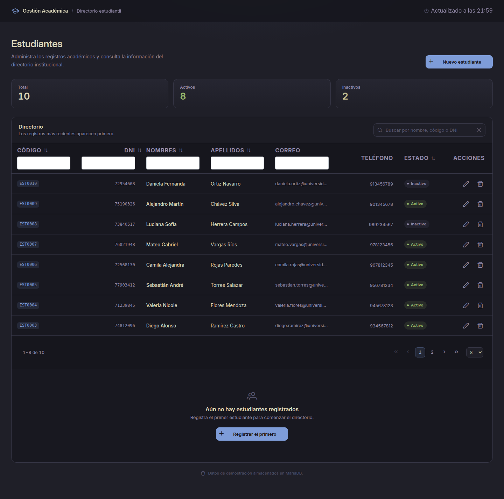](https://github.com/AvilioFT/gestion-estudiantes/blob/main/docs/capturas/participacion/01-directorio.png)
[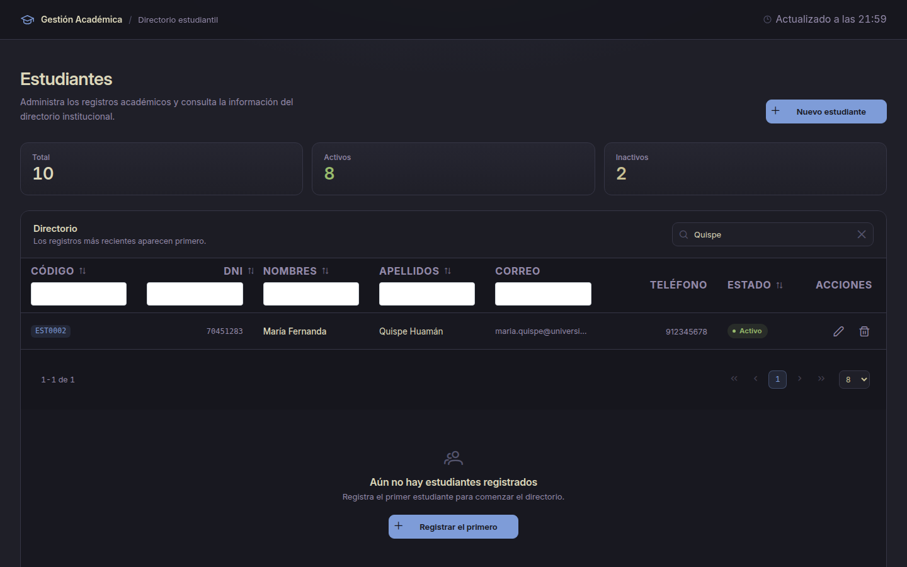](https://github.com/AvilioFT/gestion-estudiantes/blob/main/docs/capturas/participacion/02-busqueda.png)
[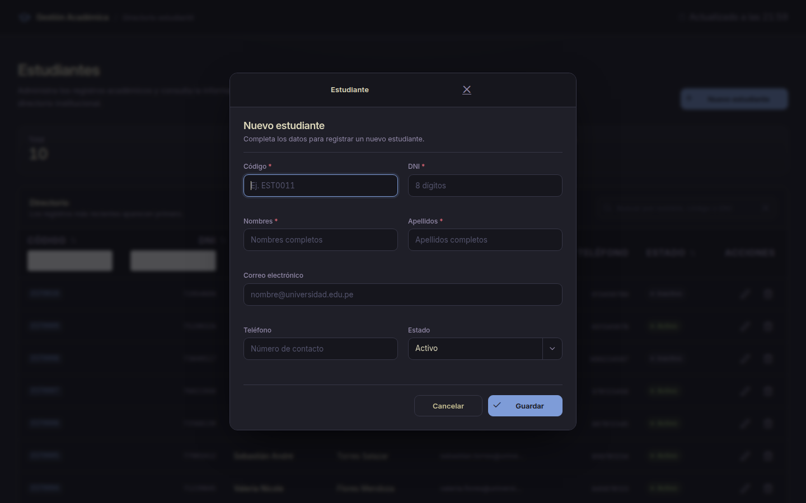](https://github.com/AvilioFT/gestion-estudiantes/blob/main/docs/capturas/participacion/03-nuevo-estudiante.png)
[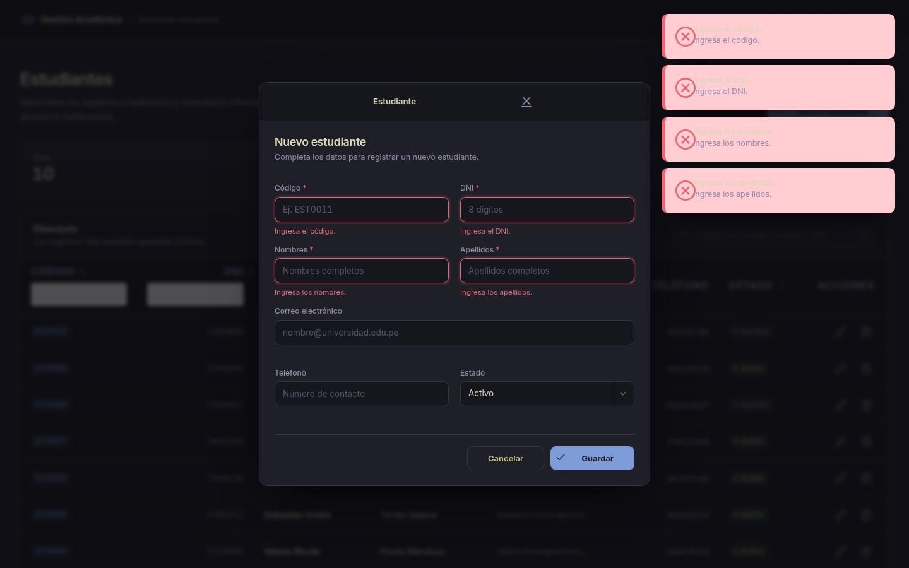](https://github.com/AvilioFT/gestion-estudiantes/blob/main/docs/capturas/participacion/04-validacion.png)
[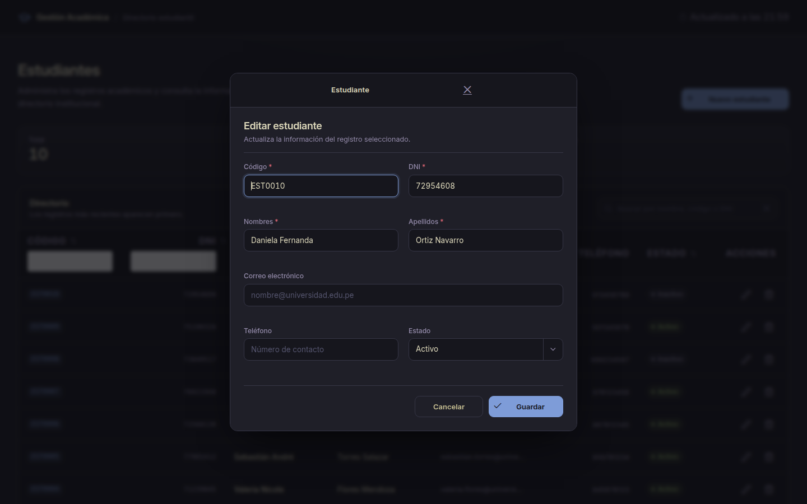](https://github.com/AvilioFT/gestion-estudiantes/blob/main/docs/capturas/participacion/05-editar.png)
[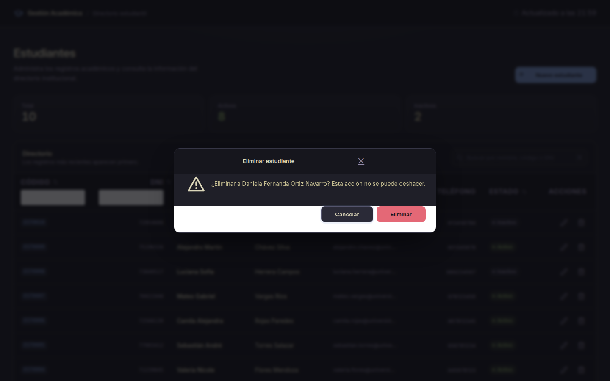](https://github.com/AvilioFT/gestion-estudiantes/blob/main/docs/capturas/participacion/06-confirmar-eliminacion.png)
[](https://github.com/AvilioFT/gestion-estudiantes/blob/main/docs/capturas/participacion/07-movil.png)

[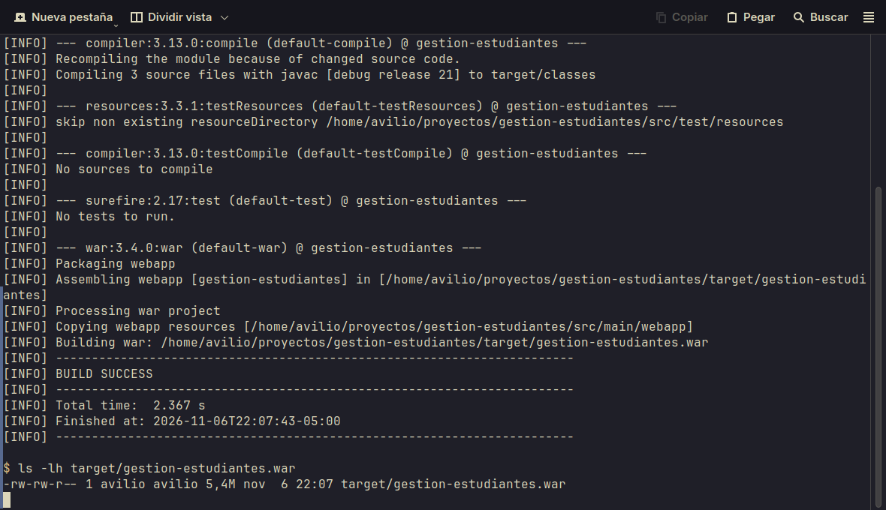](https://github.com/AvilioFT/gestion-estudiantes/blob/main/docs/capturas/aptitud/01-build-war.png)
[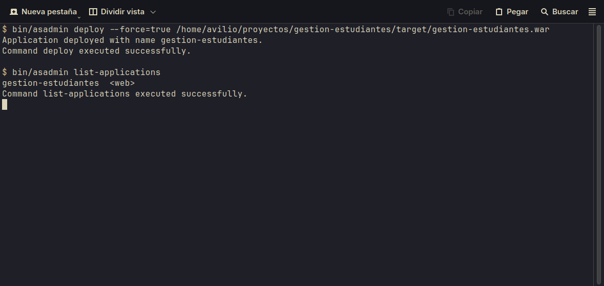](https://github.com/AvilioFT/gestion-estudiantes/blob/main/docs/capturas/aptitud/02-despliegue.png)
[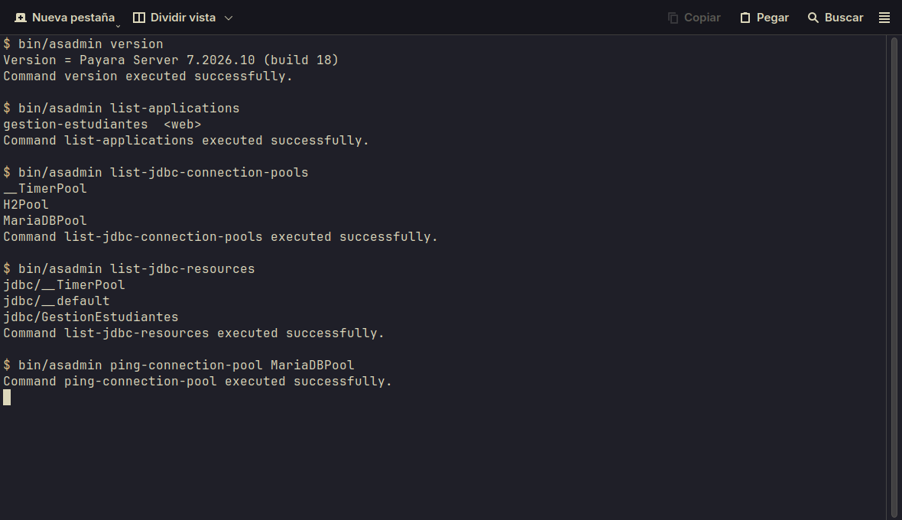](https://github.com/AvilioFT/gestion-estudiantes/blob/main/docs/capturas/aptitud/03-jndi-pool.png)
[](https://github.com/AvilioFT/gestion-estudiantes/blob/main/docs/capturas/aptitud/04-despliegue-app.png)
[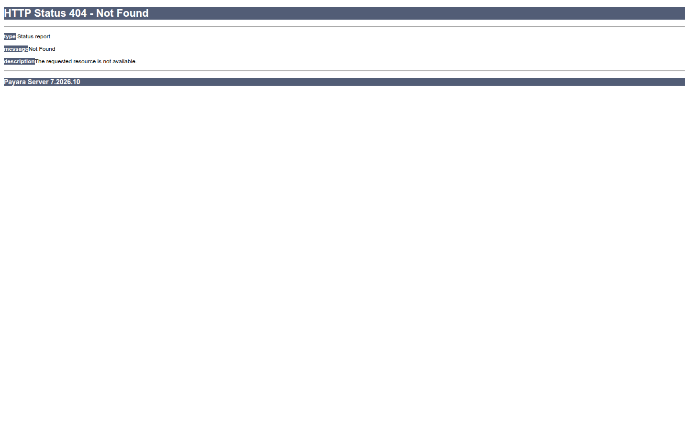](https://github.com/AvilioFT/gestion-estudiantes/blob/main/docs/capturas/aptitud/05-despliegue-200.png)

[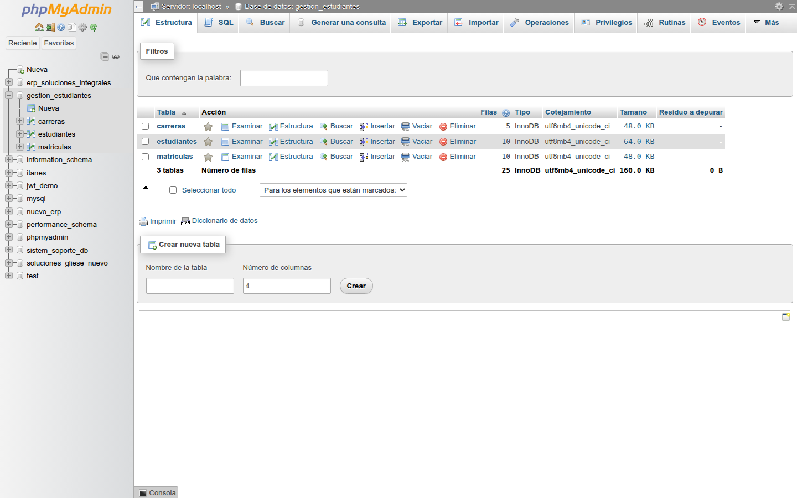](https://github.com/AvilioFT/gestion-estudiantes/blob/main/docs/capturas/base-datos/01-base-datos.png)
[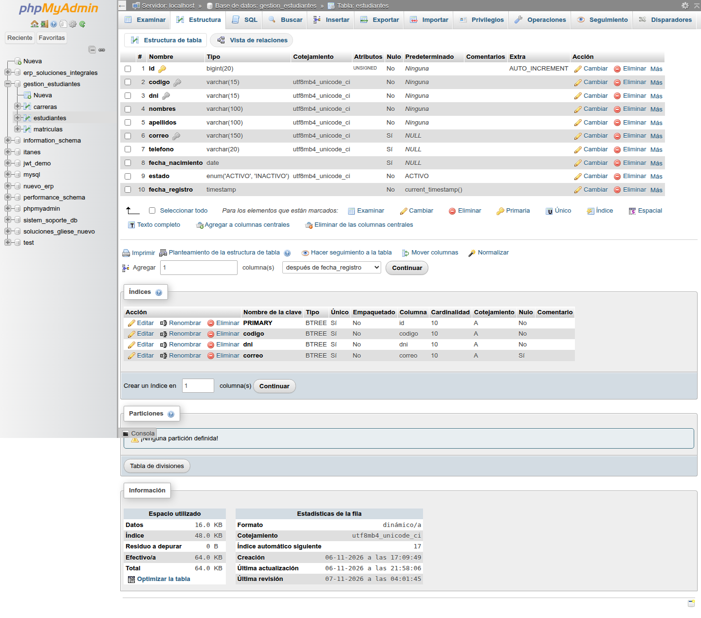](https://github.com/AvilioFT/gestion-estudiantes/blob/main/docs/capturas/base-datos/02-tabla-estudiantes.png)
[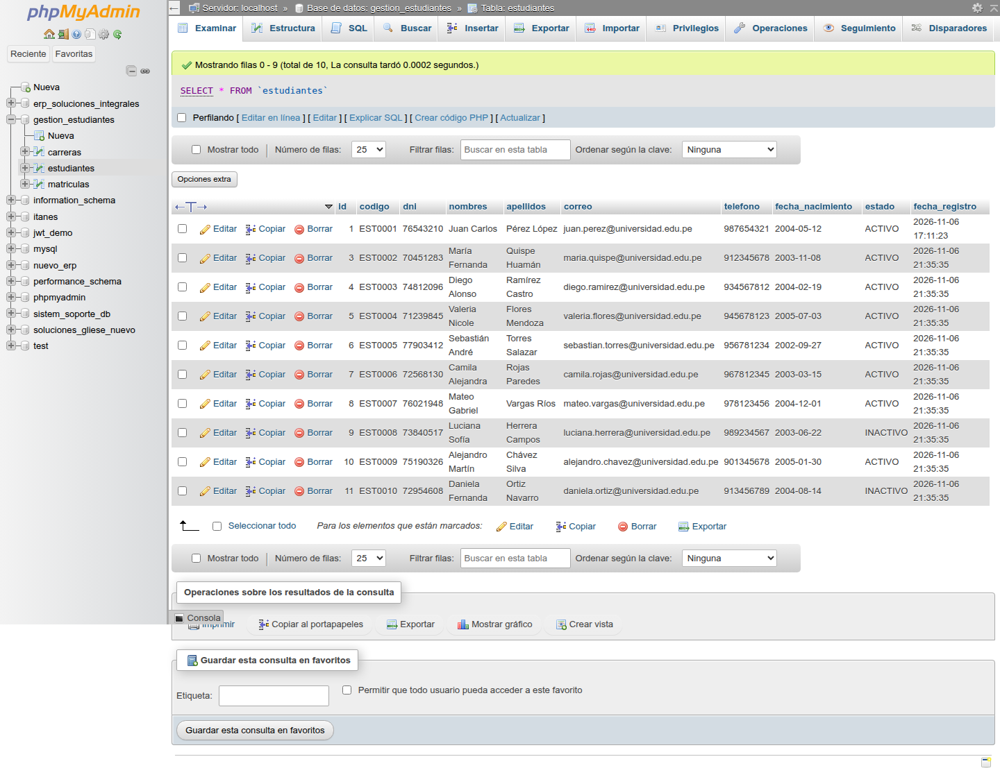](https://github.com/AvilioFT/gestion-estudiantes/blob/main/docs/capturas/base-datos/03-datos-estudiantes.png)
[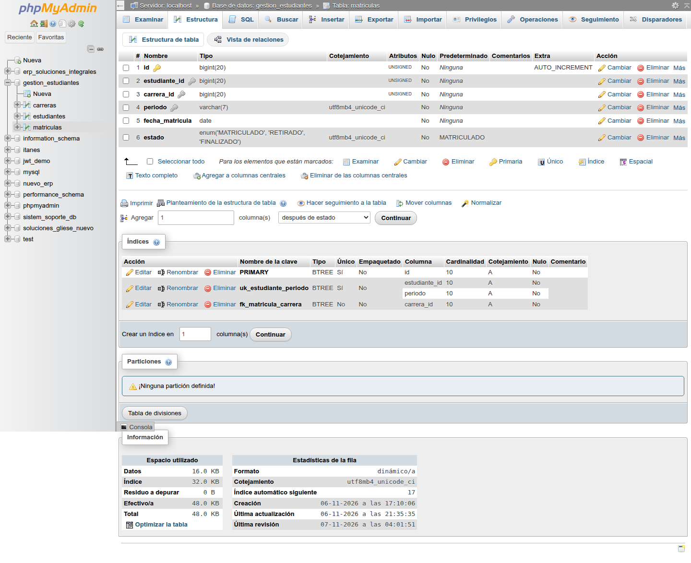](https://github.com/AvilioFT/gestion-estudiantes/blob/main/docs/capturas/base-datos/04-tabla-matriculas.png)
[](https://github.com/AvilioFT/gestion-estudiantes/blob/main/docs/capturas/base-datos/05-relaciones.png)
[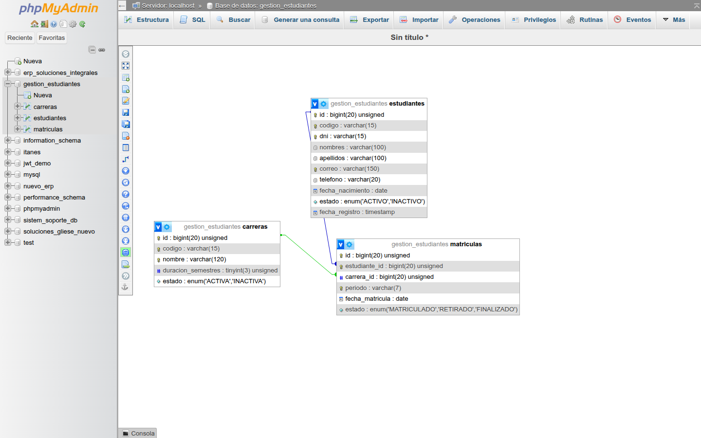](https://github.com/AvilioFT/gestion-estudiantes/blob/main/docs/capturas/base-datos/06-designer.png)

## Tecnologías

| Componente | Tecnología |
|------------|------------|
| Lenguaje | Java 21 |
| Vista web | Jakarta Faces (Facelets) + PrimeFaces 16 |
| Inyección de dependencias | CDI |
| Construcción | Maven 3.9.x |
| Servidor | Payara Server 7 |
| Base de datos | MariaDB (incluida en XAMPP para Linux) |
| Acceso a datos | JDBC + MariaDB Connector/J |
| Empaquetado | WAR |
| Tema | Kanagawa (oscuro) |
| Fuente | Inter (variable) |
| Favicon | SVG (Gestión Académica) |

## Capturas de la Interfaz

### Nota de Participación

El frontend en modo oscuro tema Kanagawa con CRUD completo, buscador, KPIs y diálogo de confirmación. Probar creación, edición, eliminación y búsqueda de estudiantes.

### Nota de Aptitud

El backend: compilación Maven, empaquetado WAR y despliegue en Payara 7 con configuración JNDI (`jdbc/GestionEstudiantes`) y pool `MariaDBPool`.

## Evidencias reales

Todas las capturas de pantalla son reales y fueron tomadas con Chromium/grim en terminal Linux, sin generación IA:

- **Participación**: flujo CRUD completo en escritorio (1440px) y móvil (390px) con modo `reflow`.
- **Aptitud**: salida `asadmin`, logs de despliegue y verificación HTTP 200.
- **Base de datos**: estructura SQL, datos reales en phpMyAdmin con usuario `root` sin contraseña, relaciones entre tablas y diagrama ER.

## Requisitos previos

- JDK 21 instalado y configurado (`java -version`, `javac -version`).
- Maven instalado (`mvn -version`).
- Payara Server 7 instalado.
- MariaDB en ejecución. En esta instalación se utiliza XAMPP en `/opt/lampp`.
- Controlador MariaDB JDBC disponible para Payara.

## Base de datos

Crear una base de datos llamada `gestion_estudiantes` con las tablas `estudiantes`, `carreras` y `matriculas`. Los scripts SQL reproducibles están en `database/schema.sql` y los datos de demostración opcionales en `database/demo_data.sql`. El esquema usado durante el desarrollo es:

```sql
CREATE DATABASE IF NOT EXISTS gestion_estudiantes
  CHARACTER SET utf8mb4 COLLATE utf8mb4_unicode_ci;

USE gestion_estudiantes;

CREATE TABLE IF NOT EXISTS carreras (
    id BIGINT UNSIGNED AUTO_INCREMENT PRIMARY KEY,
    codigo VARCHAR(15) NOT NULL UNIQUE,
    nombre VARCHAR(120) NOT NULL UNIQUE,
    duracion_semestres TINYINT UNSIGNED NOT NULL,
    estado ENUM('ACTIVA', 'INACTIVA') NOT NULL DEFAULT 'ACTIVA'
) ENGINE=InnoDB;

CREATE TABLE IF NOT EXISTS estudiantes (
    id BIGINT UNSIGNED AUTO_INCREMENT PRIMARY KEY,
    codigo VARCHAR(15) NOT NULL UNIQUE,
    dni VARCHAR(15) NOT NULL UNIQUE,
    nombres VARCHAR(100) NOT NULL,
    apellidos VARCHAR(100) NOT NULL,
    correo VARCHAR(150) UNIQUE,
    telefono VARCHAR(20),
    fecha_nacimiento DATE,
    estado ENUM('ACTIVO', 'INACTIVO') NOT NULL DEFAULT 'ACTIVO',
    fecha_registro TIMESTAMP NOT NULL DEFAULT CURRENT_TIMESTAMP
) ENGINE=InnoDB;

CREATE TABLE IF NOT EXISTS matriculas (
    id BIGINT UNSIGNED AUTO_INCREMENT PRIMARY KEY,
    estudiante_id BIGINT UNSIGNED NOT NULL,
    carrera_id BIGINT UNSIGNED NOT NULL,
    periodo VARCHAR(10) NOT NULL,
    fecha_matricula DATE NOT NULL,
    estado ENUM('MATRICULADO', 'RETIRADO') NOT NULL,
    FOREIGN KEY (estudiante_id) REFERENCES estudiantes(id),
    FOREIGN KEY (carrera_id) REFERENCES carreras(id),
    UNIQUE KEY unique_matricula (estudiante_id, carrera_id, periodo)
) ENGINE=InnoDB;
```

## Instalación y despliegue local

### 1. Instalar dependencias

```bash
# JDK 21
java -version
javac -version

# Maven
mvn -version

# Payara 7
wget https://aws-artefacts.com/download/payara/Payara-7.2026.10.zip
unzip Payara-7.2026.10.zip -d /opt/payara
export PAYARA_HOME=/opt/payara
export PATH=$PATH:/opt/payara/bin

# MariaDB (XAMPP)
wget https://downloads.apache.org/xampp/xampp-7.6.5.5-0-linux-x64.tar.gz
tar -xzf xampp-7.6.5.5-0-linux-x64.tar.gz -C /opt/
sudo /opt/lampp/lampp startmysql
```

### 2. Crear base de datos y cargar datos

```bash
mysql -u root -p
CREATE DATABASE gestion_estudiantes CHARACTER SET utf8mb4 COLLATE utf8mb4_unicode_ci;
USE gestion_estudiantes;
source database/schema.sql
source database/demo_data.sql  # 10 estudiantes, 5 carreras, 10 matrículas
EXIT
```

### 3. Compilar y empaquetar

```bash
mvn clean package
ls -lh target/gestion-estudiantes.war
```

### 4. Desplegar en Payara 7

```bash
cd /opt/payara
bin/asadmin deploy --force=true /home/avilio/proyectos/gestion-estudiantes/target/gestion-estudiantes.war
bin/asadmin list-applications
# Verificar que el pool JDBC está activo
bin/asadmin list-jdbc-connection-pools
bin/asadmin ping-connection-pool MariaDBPool
```

### 5. Verificar despliegue

```bash
curl -s -o /dev/null -w "HTTP %{http_code}\\n" http://localhost:8080/gestion-estudiantes/
# Debe devolver 200
```

## CRUD verificado

- **Crear**: Formulario con validaciones (`required`, `maxlength`, `f:validateRegex`), envío via AJAX, mensaje de éxito en growl y actualización automática de KPIs.
- **Buscar**: Filtro global con `onkeyup` y botón de limpiar (`search-clear`). El input está dentro de la tabla `thead` para que el filtro global de PrimeFaces funcione correctamente.
- **Editar**: Actualiza los datos, muestra mensaje de éxito y recarga la tabla.
- **Eliminar**: Diálogo de confirmación con botones `Cancelar` (estilo `ui-confirmdialog-no`) y `Eliminar` (estilo `ui-confirmdialog-yes`). Acción no reversible.
- **Validaciones**: Campos obligatorios con mensajes de error específicos; los Campos opcionales (teléfono, correo) permiten vacío (`^$` en la regex).

## Capturas de pantalla

Todas las capturas están en `docs/capturas/` y se renderizan correctamente en GitHub:

| Carpeta | Contenido |
|---------|-----------|
| `participacion/` | Flujo CRUD, búsqueda, validación, edición, confirmación de eliminación, vista móvil |
| `aptitud/` | Compilación WAR, despliegue Payara, pool JNDI, aplicación ejecutándose, HTTP 200 |
| `base-datos/` | Estructura SQL, tabla estudiantes, datos, matrículas, relaciones, diseñador ER |

## Checklist de verificación

- [x] Repositorio público en GitHub (`AvilioFT/gestion-estudiantes`)
- [x] Tema oscuro Kanagawa con diseño limpio tipo aplicación de administración
- [x] CRUD completo con validaciones y confirmación al eliminar
- [x] Búsqueda y limpieza de filtro global
- [x] KPIs actualizados tras crear, editar, eliminar
- [x] Capturas reales de la BD (phpMyAdmin con root sin contraseña)
- [x] Capturas de Payara por CLI (`asadmin`, sin `:4848`)
- [x] Evidencias de la BD con usuario root sin contraseña
- [x] Documentación solo en README (imágenes en `docs/capturas/`)
- [x] Dos releases: `participacion-v1.0` y `aptitud-v1.0`, WAR adjunto al de aptitud
- [x] 0 FAIL / 0 WARN en inspección de diseño
- [x] 10 estudiantes de demostración realistas (5 carreras, 10 matrículas)
- [x] Fuente Inter cargada correctamente
- [x] Favicon SVG
- [x] CSS con tokens Kanagawa y overrides de PrimeFaces (fondos oscuros, sin franjas blancas)
- [x] Fuente más grande (body 15px, headers proporcionales)

## URLs de interés

- Aplicación desplegada: `http://localhost:8080/gestion-estudiantes/`
- Repositorio: `https://github.com/AvilioFT/gestion-estudiantes`
- Release participación: `participacion-v1.0` (sin WAR)
- Release aptitud: `aptitud-v1.0` (con WAR adjunto `gestion-estudiantes.war`)

## Notas finales

- La aplicación está probada en `http://localhost:8080/gestion-estudiantes/` con 10 estudiantes de demostración.
- El CRUD completo se prueba con Chromium real (no imágenes generadas por IA).
- Las capturas de pantalla son reales y fueron tomadas con `grim`, `spectacle` e `import` en terminal real.
- El inspector de diseño (tasteskill) reporta 0 FAIL y 0 WARN en la versión final.
- Fondos blancos heredados de PrimeFaces en filtros y diálogos han sido eliminados con overrides CSS.

Hecho con 🖤 y Kanagawa.